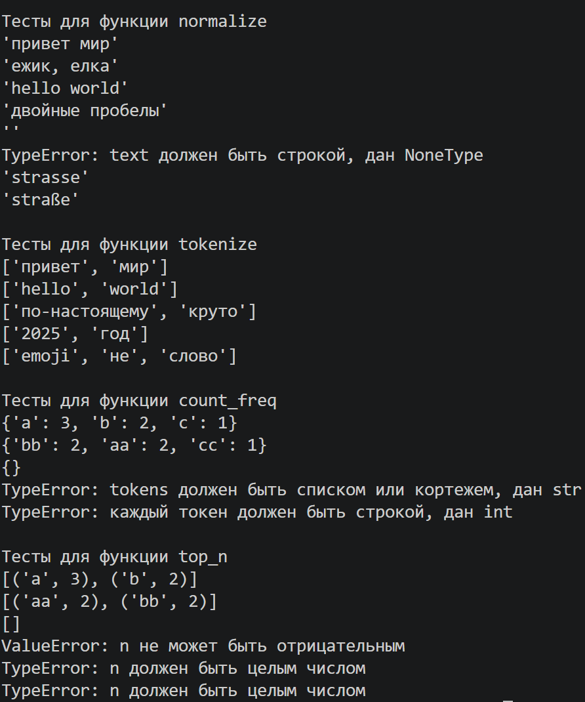

# ЛР3 — Обработка текста (строки, регулярные выражения, словари)

## Задание A — Библиотека работы с текстом

Файл: [text.py](../lib/text.py)

### Нормализовать текст: casefold, ё → е, управляющие символы в пробелы, схлопнуть пробелы.
```py
def normalize(text: str, *, casefold: bool = True, yo2e: bool = True) -> str:

    if not isinstance(text, str):
        raise TypeError(f"text должен быть строкой, дан {type(text).__name__}")

    if casefold:
        text = text.casefold()
    else:
        text = text.lower()
    if yo2e:
        text = text.replace("ё", "е").replace("Ё", "Е")

    text = "".join(ch if ch.isprintable() else " " for ch in text)

    return " ".join(text.split())
```
### Разбить текст на слова (дефис внутри слова сохраняется, числа — тоже слова).
```py
import re

# слово: буквы/цифры, внутри допускаются дефисы ("по-настоящему", "из-за")
_WORD_RE = re.compile(r"\w+(?:-\w+)*")


def tokenize(text: str) -> list[str]:

    if not isinstance(text, str):
        raise TypeError(f"text должен быть строкой, дан {type(text).__name__}")

    return _WORD_RE.findall(text)
```
### Посчитать частоты слов.
```py
def count_freq(tokens: list[str]) -> dict[str, int]:

    if not isinstance(tokens, (list, tuple)):
        raise TypeError(f"tokens должен быть списком или кортежем, дан {type(tokens).__name__}")

    freq: dict[str, int] = {}
    for token in tokens:
        if not isinstance(token, str):
            raise TypeError(f"каждый токен должен быть строкой, дан {type(token).__name__}")
        freq[token] = freq.get(token, 0) + 1
    return freq
```
### Вернуть n самых частых слов (при равенстве частот — по алфавиту).
```py
def top_n(freq: dict[str, int], n: int = 5) -> list[tuple[str, int]]:

    if not isinstance(freq, dict):
        raise TypeError(f"freq должен быть словарём, дан {type(freq).__name__}")
    # отсекаю True/False с помощью подкласса int'a - bool
    if isinstance(n, bool) or not isinstance(n, int):
        raise TypeError("n должен быть целым числом")
    if n < 0:
        raise ValueError("n не может быть отрицательным")
    return sorted(freq.items(), key=lambda pair: (-pair[1], pair[0]))[:n]
```

# ----------------------------------------
## Тест-кейсы для задания A
#### Для функции normalize:
```py
# -> 'привет мир', 'ежик, елка', 'hello world', 'двойные пробелы', '', TypeError
test_cases_normalize = ["ПрИвЕт\nМИр\t", "ёжик, Ёлка", "Hello\r\nWorld", "  двойные   пробелы  ", " \n\t ", None]
for case in test_cases_normalize:
    try:
        print(repr(normalize(case)))
    except TypeError as error:
        print("TypeError:", error)

# casefold=False -> lower(): 'strasse', 'straße'
print(repr(normalize("Straße")))
print(repr(normalize("Straße", casefold=False)))
```

#### Для функции tokenize:
```py
# -> ['привет', 'мир'], ['hello', 'world'], ['по-настоящему', 'круто'], ['2025', 'год'], ['emoji', 'не', 'слово']
test_cases_tokenize = ["привет мир", "hello,world!!!", "по-настоящему круто", "2025 год", "emoji 😀 не слово"]
for case in test_cases_tokenize:
    print(tokenize(case))
```

#### Для функции count_freq:
```py
# -> {'a': 3, 'b': 2, 'c': 1}, {'bb': 2, 'aa': 2, 'cc': 1}, {}, TypeError, TypeError
test_cases_count_freq = [["a", "b", "a", "c", "b", "a"], ["bb", "aa", "bb", "aa", "cc"], [], "abca", ["a", 1]]
for case in test_cases_count_freq:
    try:
        print(count_freq(case))
    except TypeError as error:
        print("TypeError:", error)
```

#### Для функции top_n:
```py
# -> [('a', 3), ('b', 2)], [('aa', 2), ('bb', 2)], [], ValueError, TypeError, TypeError
test_cases_top_n = [
    ({"a": 3, "b": 2, "c": 1}, 2),
    ({"bb": 2, "aa": 2, "cc": 1}, 2),
    ({}, 5),
    ({"a": 1}, -1),
    ({"a": 1}, True),
    ({"a": 1}, "2"),
]
for freq, n in test_cases_top_n:
    try:
        print(top_n(freq, n))
    except ValueError as error:
        print("ValueError:", error)
    except TypeError as error:
        print("TypeError:", error)
```
## Output:


## Задание B — Статистика по тексту из stdin

Файл: [text_stats.py](text_stats.py)

### Прочитать текст из stdin, вывести количество слов, уникальных слов и топ-5.
Скрипт читает **весь ввод до EOF** (не одну строку), поэтому многострочный текст считается целиком.
```py
import os
import sys

sys.path.insert(0, os.path.dirname(os.path.dirname(os.path.abspath(__file__))))

from lib.FuncLib import normalize, tokenize, count_freq, top_n
TOP_COUNT = 5
TABLE_MODE = os.environ.get("TEXT_STATS_TABLE") == "1"


def main() -> None:
    sys.stdin.reconfigure(encoding="utf-8")
    text = sys.stdin.read()

    tokens = tokenize(normalize(text))
    freq = count_freq(tokens)
    top = top_n(freq, TOP_COUNT)

    print(f"Всего слов: {len(tokens)}")
    print(f"Уникальных слов: {len(freq)}")
    print(f"Топ-{TOP_COUNT}:")

    if TABLE_MODE:
        print_table(top)
    else:
        for word, count in top:
            print(f"{word}:{count}")
```
### Бонус: вывести топ-слов таблицей (включается переменной окружения `TEXT_STATS_TABLE=1`).
```py
def print_table(top: list[tuple[str, int]]) -> None:
    header = "слово"
    width = max([len(header)] + [len(word) for word, _ in top])
    title = f"{header:<{width}} | частота"
    print(title)
    print("-" * len(title))
    for word, count in top:
        print(f"{word:<{width}} | {count}")
```

# ----------------------------------------
## Тест-кейсы для задания B
Запуск в PowerShell. Чтобы русский текст дошёл до скрипта, перед запуском один раз:
```
$OutputEncoding = [Text.UTF8Encoding]::new()
```
#### Обычный вывод:
```
echo "Привет, мир! Привет!!! Ёжик по-настоящему умный, мир - 2025 год. по-настоящему" | python text_stats.py
```
```
Всего слов: 10
Уникальных слов: 7
Топ-5:
мир:2
по-настоящему:2
привет:2
2025:1
год:1
```

#### Бонус — таблица:
```
$env:TEXT_STATS_TABLE = "1"
echo "Привет, мир! Привет!!! по-настоящему" | python text_stats.py
```
```
Всего слов: 4
Уникальных слов: 3
Топ-5:
слово         | частота
-----------------------
привет        | 2
мир           | 1
по-настоящему | 1
```
## Output:

