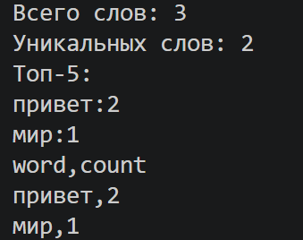

# ЛР4 — Файлы: TXT/CSV и отчёты по статистике текста

## Задание A — Чтение текста и запись CSV

Файл: [io_txt_csv.py](io_txt_csv.py)

### Прочитать файл целиком в строку (ошибки `FileNotFoundError` / `UnicodeDecodeError` пробрасываются).
```py
def read_text(path: str | Path, encoding: str = "utf-8") -> str:
    """Читает файл целиком и возвращает строку.

    Пустой файл -> "". FileNotFoundError и UnicodeDecodeError пропускаются.
    Другая кодировка: read_text("data/lab04/input_cp1251.txt", encoding="cp1251")
    """
    return Path(path).read_text(encoding=encoding)
```

```py
def read_text_auto(path: str | Path,
                   encodings: tuple[str, ...] = ("utf-8-sig", "cp1251")) -> str:
    """пробует кодировки по очереди и возвращает текст первой подошедшей."""
    data = Path(path).read_bytes()
    last_error = None
    for enc in encodings:
        try:
            return data.decode(enc)
        except UnicodeDecodeError as e:
            last_error = e
    raise ValueError(f"{path}: не подошла ни одна кодировка из {encodings}") from last_error
```
### Записать строки в CSV (UTF-8, разделитель — запятая), проверить одинаковую длину строк.
```py
def ensure_parent_dir(path: str | Path) -> None:
    """Создаёт родительские папки для path, если их нет."""
    Path(path).parent.mkdir(parents=True, exist_ok=True)


def write_csv(rows: Iterable[Sequence], path: str | Path,
              header: tuple[str, ...] | None = None) -> None:
    rows = list(rows)
    expected = len(header) if header is not None else (len(rows[0]) if rows else 0)
    for i, r in enumerate(rows):
        if len(r) != expected:
            raise ValueError(f"строка {i}: длина {len(r)}, ожидалась {expected}")

    ensure_parent_dir(path)
    with Path(path).open("w", newline="", encoding="utf-8") as f:
        w = csv.writer(f)
        if header is not None:
            w.writerow(header)
        w.writerows(rows)
```

# ----------------------------------------
## Тест-кейсы для задания A
```py
import tempfile
from pathlib import Path

TMP = Path(tempfile.gettempdir())  # пробные файлы пишу во временную папку, а не в проект

# -> 'Привет, мир! Привет!!!'
print(repr(read_text("data/lab04/input.txt")))

# -> 'Привет', 'Привет' (cp1251 явно и автоподбором)
print(repr(read_text("data/lab04/input_cp1251.txt", encoding="cp1251")))
print(repr(read_text_auto("data/lab04/input_cp1251.txt")))

# -> FileNotFoundError, UnicodeDecodeError (cp1251-файл читаем как utf-8)
for args in [("data/lab04/nope.txt",), ("data/lab04/input_cp1251.txt",)]:
    try:
        read_text(*args)
    except (FileNotFoundError, UnicodeDecodeError) as e:
        print(type(e).__name__)

# -> 'word,count\na,1\nb,2\n' (папка out/ создаётся сама)
write_csv([("a", 1), ("b", 2)], TMP / "out" / "rows.csv", header=("word", "count"))
print(repr(read_text(TMP / "out" / "rows.csv")))

# -> '' (rows=[] и header=None => пустой файл; и read_text пустого файла => "")
write_csv([], TMP / "e1.csv")
print(repr(read_text(TMP / "e1.csv")))

# -> 'word,count\n' (rows=[] и header -> только заголовок)
write_csv([], TMP / "e2.csv", header=("word", "count"))
print(repr(read_text(TMP / "e2.csv")))

# -> ValueError: строка 1: длина 1, ожидалась 2
try:
    write_csv([("a", 1), ("b",)], TMP / "bad.csv")
except ValueError as e:
    print("ValueError:", e)
```
## Output:


## Задание B — Отчёт по частотам слов

Файл: [text_report.py](text_report.py)

### Посчитать частоты слов одного файла (функции из ЛР3: `normalize`, `tokenize`, `count_freq`).
```py
def file_freq(path: Path, encoding: str | None) -> dict[str, int]:
    # без --encoding кодировку подбираю сама
    if encoding:
        text = read_text(path, encoding)
    else:
        text = read_text_auto(path)
    return count_freq(tokenize(normalize(text)))
```
### Вывести сводку: всего слов, уникальных слов, топ-5.
```py
def print_summary(freq: dict[str, int]) -> None:
    print(f"Всего слов: {sum(freq.values())}")
    print(f"Уникальных слов: {len(freq)}")
    print(f"Топ-{TOP_COUNT}:")
    for word, count in top_n(freq, TOP_COUNT):
        print(f"{word}:{count}")
```
### Собрать отчёт: CSV `word,count`, сортировка по убыванию частоты, при равенстве — по алфавиту.
```py
    try:
        per_file_rows = []
        total = {}
        for path in args.inputs:
            freq = file_freq(path, args.encoding)
            # top_n с n = len(freq) просто сортирует все слова
            for word, count in top_n(freq, len(freq)):
                per_file_rows.append((path.name, word, count))
                total[word] = total.get(word, 0) + count
    except FileNotFoundError as err1:
        print(f"Файл не найден: {err1.filename}")
        sys.exit(1)
    except ValueError as err2:
        print(f"Ошибка: {err2}")
        sys.exit(1)
    except LookupError:
        print(f"Неизвестная кодировка: {args.encoding}")
        sys.exit(1)

    total_rows = top_n(total, len(total))
    if args.per_file or args.total:
        if args.per_file:
            write_csv(per_file_rows, args.per_file, header=("file", "word", "count"))
        if args.total:
            write_csv(total_rows, args.total, header=("word", "count"))
    else:
        write_csv(total_rows, args.out, header=("word", "count"))

    print_summary(total)
```
### Аргументы командной строки (`argparse`).
| Аргумент | По умолчанию | Что делает |
|---|---|---|
| `--in` | `data/lab04/input.txt` | входной файл (★ можно несколько) |
| `--out` | `data/lab04/report.csv` | итоговый CSV `word,count` |
| `--encoding` | подбирается сама (`utf-8-sig` → `cp1251`) | кодировка входного файла |
| `--per-file` | — | ★ CSV по каждому файлу `file,word,count` |
| `--total` | — | ★ общий CSV по всем файлам `word,count` |

### Кодировки
- Без `--encoding` файл читается через `read_text_auto`: сначала `utf-8-sig` (UTF-8, в т.ч. с BOM из Блокнота), потом `cp1251` (старые русские файлы Windows).
- С `--encoding` используется ровно указанная кодировка. Если она не подходит — сообщение об ошибке, а не «кракозябры».
- Выходной CSV **всегда** в UTF-8, независимо от кодировки входа.

### Для пустого и отсутствующего входа
- **Пустой файл** → отчёт с **только заголовком** `word,count`, в сводке нули. Это не ошибка.
- **Файла нет** → сообщение `Файл не найден: ...`, код выхода 1, CSV не создаётся.
- **Неверная / неизвестная кодировка** → сообщение об ошибке, код выхода 1.

# ----------------------------------------
## Тест-кейсы для задания B
Тестовые файлы лежат в [data/lab04](../../data/lab04):

| Файл | Содержимое | Тест |
|---|---|---|
| `input.txt` | `Привет, мир! Привет!!!` (UTF-8) | A |
| `input_cp1251.txt` | `Привет` (cp1251) | C |
| `a.txt`, `b.txt` | `Привет мир` / `Привет, привет!` | D★ |
| `report.csv` | результат теста A | — |

Чтобы не плодить файлы в проекте, отчёты тестов B, C, D★ пишутся во временную папку `$env:TEMP`.

#### A. Один файл (база): `Привет, мир! Привет!!!`
```
python src/lab04/text_report.py
```
```
Всего слов: 3
Уникальных слов: 2
Топ-5:
привет:2
мир:1
```
`data/lab04/report.csv`:
```
word,count
привет,2
мир,1
```

#### B. Пустой файл
```
New-Item $env:TEMP/empty.txt -Force
python src/lab04/text_report.py --in $env:TEMP/empty.txt --out $env:TEMP/report_empty.csv
Get-Content $env:TEMP/report_empty.csv -Encoding UTF8
```
```
Всего слов: 0
Уникальных слов: 0
Топ-5:
word,count
```

#### C. Кодировка cp1251
```
python src/lab04/text_report.py --in data/lab04/input_cp1251.txt --encoding cp1251 --out $env:TEMP/report_cp1251.csv
```
```
Всего слов: 1
Уникальных слов: 1
Топ-5:
привет:1
```

#### D★. Несколько файлов
```
python src/lab04/text_report.py --in data/lab04/a.txt data/lab04/b.txt --per-file $env:TEMP/report_per_file.csv --total $env:TEMP/report_total.csv
Get-Content $env:TEMP/report_per_file.csv -Encoding UTF8
Get-Content $env:TEMP/report_total.csv -Encoding UTF8
```
```
Всего слов: 4
Уникальных слов: 2
Топ-5:
привет:3
мир:1
```
`report_per_file.csv`:
```
file,word,count
a.txt,мир,1
a.txt,привет,1
b.txt,привет,2
```
`report_total.csv`:
```
word,count
привет,3
мир,1
```

## Output:

