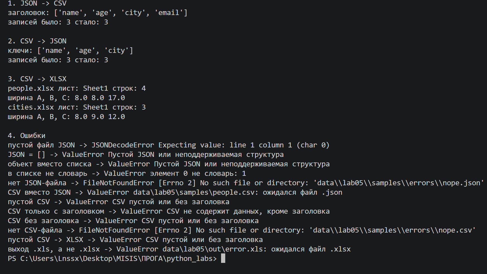
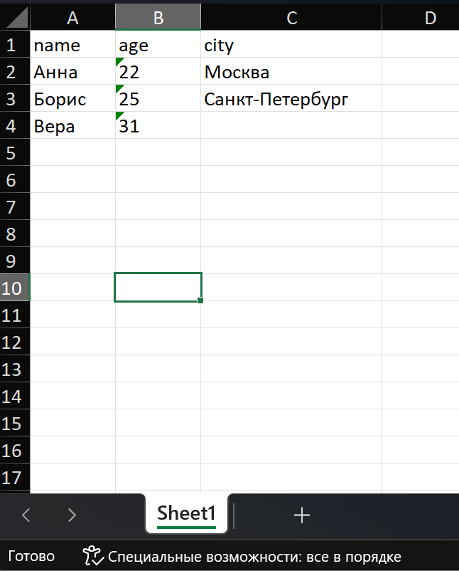
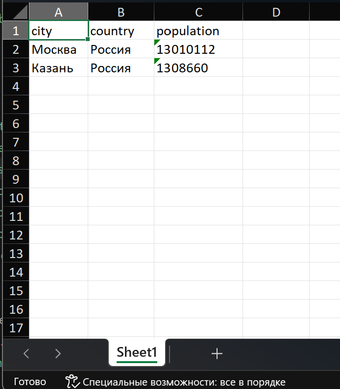

# ЛР5 — JSON и конвертации (JSON ↔ CSV, CSV → XLSX)

## Запуск

Запускать из корня репозитория (`python_labs/`), пути в коде относительные.

```
python -m pip install -r requirements.txt
python src/lab05/json_csv.py
python src/lab05/csv_xlsx.py
python src/lab05/test_cases.py
```

## Допущения

- Данные лежат в `data/lab05/samples/` и `data/lab05/out/` (а не в `data/samples/` и `data/out/`), как в ЛР4 — у каждой лабы своя папка.
- Порядок колонок в JSON → CSV: ключи первого объекта, потом новые ключи из остальных. Если поля нет — пустая строка.
- В CSV → JSON все значения остаются строками (`"age": "22"`), так в ТЗ.
- Тип файла проверяется по расширению. Кодировка везде UTF-8.
- Для XLSX — openpyxl (единственная зависимость в `requirements.txt`).

## Задание A — JSON ↔ CSV

Файл: [json_csv.py](json_csv.py)

### Проверить расширение файла (не то расширение -> `ValueError`).
```py
def check_suffix(path: Path, suffix: str) -> None:
    if path.suffix.lower() != suffix:
        raise ValueError(f"{path}: ожидался файл {suffix}")
```

### JSON → CSV: список словарей в таблицу, колонки — объединение ключей, пропуски — пустая строка.
```py
def json_to_csv(json_path: str, csv_path: str) -> None:
    src = Path(json_path)
    dst = Path(csv_path)
    check_suffix(src, ".json")
    check_suffix(dst, ".csv")

    with src.open(encoding="utf-8") as f:
        data = json.load(f)

    if not isinstance(data, list) or not data:
        raise ValueError("Пустой JSON или неподдерживаемая структура")

    for i, item in enumerate(data):
        if not isinstance(item, dict):
            raise ValueError(f"элемент {i} не словарь: {item!r}")

    fieldnames = []
    for item in data:
        for key in item:
            if key not in fieldnames:
                fieldnames.append(key)

    dst.parent.mkdir(parents=True, exist_ok=True)
    with dst.open("w", encoding="utf-8", newline="") as f:
        writer = csv.DictWriter(f, fieldnames=fieldnames, restval="")
        writer.writeheader()
        writer.writerows(data)
```

### CSV → JSON: каждая строка — словарь, заголовок обязателен, значения — строки.
```py
def csv_to_json(csv_path: str, json_path: str) -> None:
    src = Path(csv_path)
    dst = Path(json_path)
    check_suffix(src, ".csv")
    check_suffix(dst, ".json")

    with src.open(encoding="utf-8", newline="") as f:
        reader = csv.DictReader(f)
        if not reader.fieldnames or "" in reader.fieldnames:
            raise ValueError("CSV пустой или без заголовка")
        rows = list(reader)

    if not rows:
        raise ValueError("CSV не содержит данных, кроме заголовка")

    dst.parent.mkdir(parents=True, exist_ok=True)
    with dst.open("w", encoding="utf-8") as f:
        json.dump(rows, f, ensure_ascii=False, indent=2)
```

# ----------------------------------------
## Тест-кейсы для задания A

Все проверки в [test_cases.py](test_cases.py). Входные файлы — [data/lab05/samples](../../data/lab05/samples), результаты — [data/lab05/out](../../data/lab05/out), плохие файлы для ошибок — [data/lab05/samples/errors](../../data/lab05/samples/errors).

#### JSON → CSV

`people.json` (у Бориса есть лишний `email`, у Веры нет `city`):
```json
[
  {"name": "Анна", "age": 22, "city": "Москва"},
  {"name": "Борис", "age": 25, "city": "Санкт-Петербург", "email": "boris@mail.ru"},
  {"name": "Вера", "age": 31}
]
```
`people_from_json.csv`:
```
name,age,city,email
Анна,22,Москва,
Борис,25,Санкт-Петербург,boris@mail.ru
Вера,31,,
```

#### CSV → JSON

`people.csv`:
```
name,age,city
Анна,22,Москва
Борис,25,Санкт-Петербург
Вера,31,
```
`people_from_csv.json`:
```json
[
  {"name": "Анна", "age": "22", "city": "Москва"},
  {"name": "Борис", "age": "25", "city": "Санкт-Петербург"},
  {"name": "Вера", "age": "31", "city": ""}
]
```

#### Ошибки
- пустой / кривой JSON, `[]`, объект вместо списка, не словари в списке -> `ValueError`
- пустой CSV, CSV без заголовка, CSV только с заголовком -> `ValueError`
- не то расширение файла -> `ValueError`
- файла нет -> `FileNotFoundError`

```
python src/lab05/test_cases.py
```

## Output:


## Задание B — CSV → XLSX

Файл: [csv_xlsx.py](csv_xlsx.py)

### CSV → XLSX: лист "Sheet1", ширина колонки по самому длинному значению (минимум 8).
```py
MIN_WIDTH = 8


def csv_to_xlsx(csv_path: str, xlsx_path: str) -> None:
    src = Path(csv_path)
    dst = Path(xlsx_path)
    if src.suffix.lower() != ".csv":
        raise ValueError(f"{src}: ожидался файл .csv")
    if dst.suffix.lower() != ".xlsx":
        raise ValueError(f"{dst}: ожидался файл .xlsx")

    with src.open(encoding="utf-8", newline="") as f:
        rows = list(csv.reader(f))

    if not rows or not any(rows[0]):
        raise ValueError("CSV пустой или без заголовка")

    wb = Workbook()
    ws = wb.active
    ws.title = "Sheet1"

    widths = {}  # номер колонки -> длина самого длинного значения
    for row in rows:
        ws.append(row)
        for col, value in enumerate(row, start=1):
            widths[col] = max(widths.get(col, 0), len(value))

    for col, width in widths.items():
        ws.column_dimensions[get_column_letter(col)].width = max(width + 2, MIN_WIDTH)

    dst.parent.mkdir(parents=True, exist_ok=True)
    wb.save(dst)
```

# ----------------------------------------
## Тест-кейсы для задания B

#### people.csv → people.xlsx


#### cities.csv → cities.xlsx


Пустой CSV и выходной файл не `.xlsx` -> `ValueError` (тоже в [test_cases.py](test_cases.py), см. Output выше).
